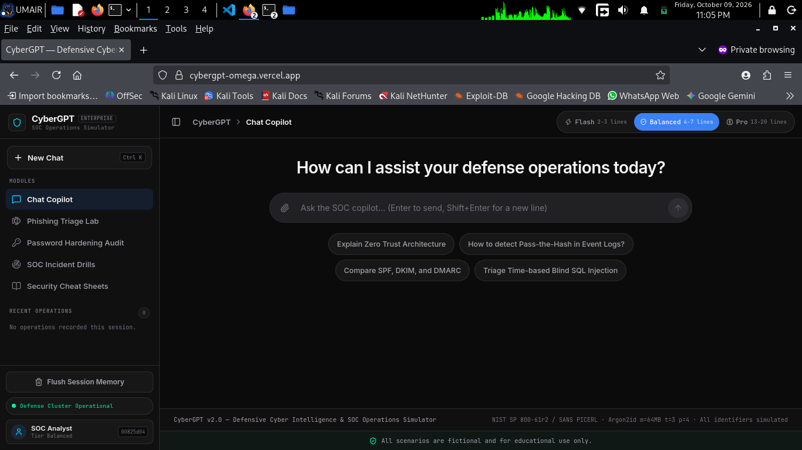

<div align="center">

# 🛡️ CyberGPT — Enterprise SOC Intelligence & Defensive Simulation Platform

[](https://cybergpt-omega.vercel.app)
[](https://www.cybok.org)
[](https://cybergpt-omega.vercel.app)
[](LICENSE)

<p align="center">
  <b>Autonomous Defensive Copilot • Offline-First CyBOK v1.1.0 Engine • Bring Your Own Key (BYOK) Architecture • Interactive SOC Drills</b>
</p>

<!-- Application Preview Banner -->
<p align="center">
  <a href="https://cybergpt-omega.vercel.app" target="_blank">
    
  </a>
</p>

[🌐 Open Live Web App](https://cybergpt-omega.vercel.app) • [🔑 BYOK Setup Guide](#-supercharge-with-your-own-api-keys-byok) • [🎯 Key Modules](#-key-modules) • [🛠️ Tech Stack](#️-technology-stack) • [⚙️ Local Setup](#️-quickstart--local-setup) • [📜 Educational Disclaimer](#-compliance--educational-disclaimer)

</div>

---

## ⚡ Overview

**CyberGPT** is an enterprise-grade defensive cybersecurity simulator, educational copilot, and hands-on SOC training workbench developed by **Muhammad Umair**. Built to bridge the gap between abstract academic concepts and real-world blue teaming, CyberGPT integrates the entire **CyBOK v1.1.0 (Cyber Security Body of Knowledge)** framework with simulated telemetry analysis, attack mitigation workflows, and daily interactive learning targets.

---

## 🔑 Supercharge with Your Own API Keys (BYOK Architecture)

> 💡 **Notice on Default Model vs. Custom API Keys:**
> - **Default / Out-of-the-Box Mode:** CyberGPT runs an integrated **Offline CyBOK Engine** alongside a lightweight shared hosted model. It answers core cybersecurity definitions, identity queries, and known attack patterns instantly (sub-5ms) with zero token usage. However, complex multi-step reasoning or high-volume open-ended questions may hit shared rate limits.
> - **Unlock Maximum Intelligence (Perfection Mode):** If you want cutting-edge reasoning (GPT-4o, Claude 3.5 Sonnet, or dedicated NVIDIA NIM), click the **⚙️ Settings / API Keys** button in the top navigation bar.

### Supported Providers:
1. **NVIDIA NIM API:** Add your own key (`nvapi-...`) to access high-throughput models like `z-ai/glm-5.3` or `meta/llama-3.3-70b-instruct`.
2. **OpenAI:** Add your OpenAI key (`sk-...`) to route complex triage questions to `gpt-4o` or `gpt-4o-mini`.
3. **Anthropic Claude:** Plug in your Anthropic key (`sk-ant-...`) for comprehensive analytical breakdowns using `claude-3-5-sonnet`.

*Your API keys are stored strictly inside your browser's `localStorage` (`cybergpt_custom_api_key`) and are never written to any database or backend server disk.*

---

## 🎯 Key Modules

### 1. 💬 Dual-Mode Copilot (`[🛡️ Cyber]` & `[💬 Normal]`)
- **Cyber Mode:** Focused strictly on defensive cybersecurity, attack telemetry analysis, and digital forensics. Automatically rejects unrelated queries with a 1-click action chip: `[💬 Switch to Normal Chat & Ask Again]`.
- **Normal Mode:** Thoroughly answers general software engineering, trading, financial concepts, and everyday computing questions.
- **Dynamic CyBOK Engine:** Ingests all 21 CyBOK Knowledge Areas across 5 major categories (Human/Org, Attacks & Defences, Systems Security, Software Security, Infrastructure Security). Answers concept queries (Zero Trust, CIA Triad, Kerberos) with plain analogies and core pillars rather than forcing irrelevant Event IDs.
- **Fluid Typing Animation:** Responsive 3-dot pulse indicators give real-time feedback while the LLM generates output.

### 2. 📅 Dark Cyber Study Planner
- **Target Setting:** Create daily lab targets (e.g., 3 labs today, 5 tomorrow) filtered by difficulty (`Beginner`, `Intermediate`, `Advanced`).
- **Interactive Tracking:** Daily checklist views (`[Today]`, `[Tomorrow]`, `[This Week]`), active goals counter, streak badges, and earned XP.
- **Client Persistence:** Full state persistence in `localStorage` (`cyber_study_planner_v1`) with JSON Export/Import capabilities.

### 3. 🎣 Phishing Triage Simulator (TryHackMe Style)
- **Real-World Attack Vectors:** Payroll Diversion Phishing, Quishing (QR code MFA interception), Illicit OAuth 2.0 Consent Grants, and Staged LNK Archives.
- **RFC Safety Standards:** Strictly utilizes RFC 2606 reserved domains (`.example`) and RFC 5737 documentation subnets (`203.0.113.0/24`, `198.51.100.0/24`).
- **SANS PICERL Framework:** Automated decision evaluations featuring actionable remediation steps and collapsible technical hints.

### 4. 🚨 SOC Incident Response Drills (33+ Labs Across 8 Categories)
- Real-world triage across Endpoint Defense, Active Directory, Web AppSec, Cloud/IAM, Password Hardening, Network Traffic, and Logs/SIEM.
- Scenarios include: Obfuscated PowerShell C2 execution, RDP Brute Force (`Event 4625` ➔ `4624 Type 10`), Kerberoasting (`RC4 0x17`), Lateral Movement via PsExec (`Event 7045`), Time-based Blind SQLi, and AWS S3 Public Bucket Exposure.

### 5. 🔐 Deterministic Password Audit & Hardening
- Mathematical Shannon entropy calculation executing purely client-side without keystroke logging.
- Instant generation of enterprise-hardened variants (e.g., `ZacPaul0890` ➔ `^%$Zac%Paul0890_#Sec99`) with 1-click clipboard copying.
- Production-standard Argon2id (`m=64MB, t=3, p=4`) and bcrypt hashing guidelines.

### 6. 📑 3-Tier Defensive Cheat Sheets
- **🟢 Beginner:** Critical Port Threats (21, 22, 53, 80, 443, 445, 3389), Essential Linux Hardening Commands, and Nmap Reconnaissance flags.
- **🟡 Intermediate:** OWASP Top 10 Countermeasures, Windows Security Event IDs (`4624`, `4625`, `4688`, `7045`), and Sysmon telemetry guides.
- **🔴 Advanced:** Active Directory Exploit Defense (Kerberoasting, DCSync), Splunk SPL Threat Hunting Queries, and Volatility 3 Memory Forensics commands.

---

## 🛡️ 6-Pillar Application Security Architecture

| Security Pillar | Production Enforcement Mechanism |
| :--- | :--- |
| **1. Rate Limiting** | Hybrid IP (35 req/min burst) + client session tracking. Classroom/NAT friendly. Returns HTTP 429 JSON with `Retry-After`. |
| **2. Input Validation** | Strict server-side caps (8,000 chars for chat, 15,000 for analyzer). Client markdown rendered safely via `DOMPurify`. User telemetry wrapped in injection-safe boundaries. |
| **3. Secrets Isolation** | Zero credentials or keys in source code. Environment variables loaded via `.env` (gitignored). `.env.example` contains sanitized placeholders. |
| **4. Dependencies** | Clean `pip-audit` and `npm audit` verification with zero high/critical vulnerabilities. |
| **5. Error Handling** | Production config `DEBUG = False`. Generic JSON error responses (`{"success": false, "error": "Operational error"}`) without leaking stack traces or host paths. |
| **6. File Upload Safety** | Restricted to `.log`, `.txt`, `.json`, `.pcap`, `.png`, `.jpg` (Max 5MB). Processed strictly in-memory as inert data. |

---

## 🛠️ Technology Stack

| Layer | Component |
| :--- | :--- |
| **Backend Framework** | Python 3, Flask, Gunicorn |
| **AI Orchestration** | NVIDIA NIM API (`https://integrate.api.nvidia.com/v1`) + BYOK Multi-Provider Hub |
| **Knowledge Engine** | Offline CyBOK v1.1.0 Parser & Fuzzy Matcher (`services/knowledge_engine.py`) |
| **Frontend Architecture** | Vanilla JavaScript (ES6+), Obsidian Dark CSS Tokens, Lucide SVG Icons |
| **Sanitization & Markdown** | DOMPurify, Marked.js |
| **Testing Harness** | Playwright (Chromium & Firefox), pytest, Node.js Syntax Verifier |
| **Deployment & Hosting** | Vercel Serverless Edge Architecture |

---

## ⚙️ Quickstart / Local Setup

### 1. Clone the Repository
```bash
git clone [https://github.com/umairs759/cybergpt.git](https://github.com/umairs759/cybergpt.git)
cd cybergpt
```
## 2. Setup Virtual Environment
```
python3 -m venv .venv
source .venv/bin/activate
pip install -r requirements.txt
```

## 3. Configure Environment Variables

Copy .env.example to .env:
Bash

cp .env.example .env

Add your optional server-level keys:
Code snippet

SECRET_KEY=cybergpt-soc-enterprise-key-2026
NVIDIA_BASE_URL=[https://integrate.api.nvidia.com/v1](https://integrate.api.nvidia.com/v1)
NVIDIA_API_KEY=your_nvidia_api_key_here

4. Launch Application

Bash

python3 app.py
```
Open your browser and navigate to http://127.0.0.1:5000.
```
### 📜 Compliance & Educational Disclaimer

Notice: All scenarios, raw event telemetry logs, headers, domain names, and forensic artifacts within CyberGPT are entirely fictional and engineered strictly for educational defensive training. Real brand lookalikes have been substituted with RFC 2606 reserved namespaces (.example, .test) and RFC 5737 documentation network ranges (198.51.100.0/24, 203.0.113.0/24).
